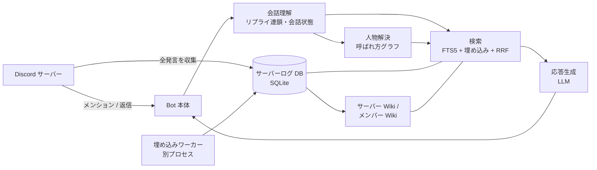

# nezubot-discrod


**メンションに答える Discord AI Bot。** サーバー全体の発言ログを検索（RAG）して
過去の会話や人物について答え、メンバーごとの記憶（Wiki）を持ちます。
人格（persona）は設定ファイル側に分離してあるので、名前や口調の例外を
コードを触らずに差し替えて、別のサーバーの別の Bot として再配備できます。

## 目次

- [特徴](#特徴)
- [アーキテクチャ](#アーキテクチャ)
- [コマンド](#コマンド)
- [必要要件](#必要要件)
- [クイックスタート](#クイックスタート)
- [設定](#設定)
- [プロジェクト構成](#プロジェクト構成)
- [データについて（重要）](#データについて重要)
- [運用メモ](#運用メモ)
- [ドキュメント](#ドキュメント)
- [開発](#開発)
- [参考](#参考)
- [ライセンス](#ライセンス)

## 特徴

### 応答と会話理解

- **メンション／返信への AI 応答** — プロバイダは OpenAI 互換 API または
  Codex（ChatGPT ログイン）のどちらかを選択
- **会話理解** — 呼ばれた発言のリプライ先（数ホップ遡る）と直近の
  チャンネルの流れをその場で読み、メンションされた人物を表示名と
  Discord ID の対応つきで把握。「この人物」などの指示語は
  リプライ先の著者 → メンションされた人 → 直近の発言者の順で解決する
- **会話状態（Conversation State）** — チャンネルごとに今の話題・中心の
  人物や発言・これまでに出た主張（根拠の発言つき）・試した解決策・
  未解決の質問を構造化して保持し、次の質問ではその状態を使って答える
- **クエリ書き換えと文脈連動の想起** — 指示語や省略のある質問は、会話
  状態とリプライ先から検索用の質問文を組み立て直す（元の質問文でも
  検索するので、書き換えが外れても従来どおり探せる）。質問文だけで
  なく、いまの会話そのものからも過去の発言を探す想起経路を持つ
- **長文回答のティーザー表示** — 一定長を超える回答は冒頭だけを
  チャンネルに出し、全文をスレッドに分ける
- **プロンプトキャッシュ最適化** — Codex 利用時は app-server を
  常駐させ、チャンネルごとの会話スレッドを使い回す。2 ターン目以降は
  新しい発言だけを送るため、入力の大半がキャッシュから処理される
- **更新履歴の自己申告** — Bot 自身の変更履歴を保持し、「何が変わった？」と
  聞かれたら履歴に基づいて答える。最新の変更は system prompt にも入る

### 検索と記憶

- **サーバーログ RAG** — 全発言を SQLite（FTS5＋埋め込みベクトル）に蓄積し、
  キーワード検索と意味検索（RRF 融合）で過去の会話を引く
- **ハイブリッド検索（任意）** — 第2の埋め込みモデル（例: 自分のサーバーの
  ログで追加学習したモデル）を3本目の経路として加え、3経路を RRF で統合する。
  env でモデルを指定したときだけ有効で、使えない環境では通常の2経路に
  自動でフォールバックする
- **適応検索** — 制限時間は経路ごと（人物の特定・字句検索・埋め込み
  検索・補助経路）に分け、打ち切りは「時間切れ」ではなく「根拠が
  足りたか」で判断する。1回目で根拠が薄いときだけ、足りなかった
  経路を大きめの制限時間でやり直す（全体の上限は安全弁として残る）
- **先読みプリフェッチ** — 会話が続いているチャンネルでは、話題や
  中心人物の根拠を手が空いている時間に先読みして短時間キャッシュ
  する。次の質問では検索済みの根拠から答え始められる
- **サーバー Wiki** — ログから人物と出来事の観察ページを自動生成し、
  出典付きで検索できる
- **メンバー Wiki** — ユーザーごとの長期記憶（好み・プロフィール）

### 人物理解

- **呼ばれ方グラフ** — 会話ログ全体から「誰が誰を何と呼んでいるか」を
  掘り起こして一覧化し、人物の特定に使う。あだ名や呼び名でも、
  **質問した本人が普段その人を何と呼んでいるか**を優先して特定する。
  新しい発言からも自動で拾い、一覧を更新し続ける
- **人物サマリ付きの回答** — 人物が特定できたときは、その人の
  Discord 名・大半の人からの呼び名・質問者からの呼び名を添えて
  答える。「Xって知ってる？」に聞き返さず直接答える
- **`/me` 理解度メーター** — Bot が自分をどれくらい理解しているかを、
  理解度 % と内訳（呼ばれ方のカバー・発言の埋め込み状況・名前や
  別名の記録・サーバー Wiki の人物記事・人物関係）で表示する。
  数字はすべて実際のデータからの計測。`/me` を使った人は
  「徹底理解の優先対象」になり、理解を深める処理（呼ばれ方の
  掘り起こし・別名の補完・再計測）が裏で継続的に実行される

### ツールと運用

- **読み取り専用 Web ツール** — Web 検索・ページ取得・Wikipedia
- **使い捨て Docker サンドボックス** — コマンド実行は隔離コンテナ内。
  既定で無効化も可
- **オーナー専用の自己改善** — `/improve` から承認付き PR を作る
- **ペルソナ分離** — Bot の名前・自己紹介 URL・特定ユーザーへの
  口調の例外は env で差し替え可能（[設定](#設定)を参照）

## アーキテクチャ



応答の流れは「会話理解 → 人物解決 → 検索 → 生成」。収集・埋め込み・
Wiki 生成は裏側で進み、応答経路は蓄積済みの索引とスナップショットを
読むだけなので、再起動直後でも数秒で検索可能な状態に戻ります
（埋め込みスナップショットはディスクに永続化）。

## コマンド

### スラッシュコマンド

| コマンド | 内容 |
|---|---|
| `/help` | 使い方を表示（自分だけ表示） |
| `/status` | 学習状況（総メッセージ数・学習人数・チャンネル数・学習率・サーバー Wiki 記事数など）を表示（自分だけ表示） |
| `/limit` | ChatGPT/Codex サブスクリプションの利用枠（5 時間枠・週間枠の残り % とリセット時刻）を表示（自分だけ表示） |
| `/me` | Bot が自分をどれくらい理解しているかを、理解度 % と内訳で表示（自分だけ表示） |
| `/search` | 閲覧できるサーバーログを検索 |
| `/wiki` | サーバー Wiki（人物・出来事）を自分だけに表示 |
| `/prompt` | 固定の system prompt を表示 |
| `/improve` | オーナー専用: 自己改善 PR を作成 |
| `/reset` | このチャンネルの会話履歴をリセット |

### プレフィックスコマンド

メッセージの先頭に付ける。メンションは不要。

| コマンド | 内容 |
|---|---|
| `n!del` | Bot の発言にリプライして送ると、その発言を取り消す（質問した本人かサーバーオーナーだけ） |

（旧 `n!help` / `n!status` / `n!limit` は廃止され、スラッシュコマンドに
移行しました。打っても何も反応しません。）

## 必要要件

- Python 3.12+
- Discord Bot アカウントと、対象サーバーへの招待
  （メッセージ内容インテントの有効化が必要）
- AI プロバイダ: OpenAI 互換 API キー、または Codex CLI＋ChatGPT ログイン
- （任意）Docker: `run_command` サンドボックス／自己改善を使う場合
- （任意）埋め込み用の計算資源: 初回の全件埋め込みは件数に応じて時間がかかる

## クイックスタート

```bash
git clone <この repo の URL>
cd nezubot-discrod
bash setup.sh   # venv 作成＋依存インストール＋ deploy.env の雛形配置
```

`deploy.env` を開いて、トークン・guild ID・owner ID・AI 設定を自分の値に
書き換えたら、起動する:

```bash
bash run.sh     # deploy.env を読み込んで Bot を起動
```

- `DISCORD_GUILD_ID` と `DISCORD_OWNER_ID` は必須で、未設定だと
  起動時に何が足りないか分かるエラーで止まる
- `deploy.env` は権限 600 で作られる。絶対にコミットしない
  （`.gitignore` 済み）
- 起動後、Bot が対象サーバーの発言をバックフィルし、埋め込みを生成する
  まで待ってから、メンションで応答を確認する
- 手動で同じことをやる場合: `python -m venv .venv` →
  `.venv/bin/pip install -e '.[dev,rag]'` → `deploy.env.example` を
  `deploy.env` にコピーして編集 → env を読み込んで `nezubot-discrod`

サーバー Wiki をまとめて再構築する場合:

```bash
.venv/bin/python -m nezubot_discrod.server_wiki --db "$HOME/.nezubot-discrod/server_log.db"
```

## 設定

全項目は `deploy.env.example` を参照（コードが読む env を網羅、
全値プレースホルダ＋用途コメント付き）。主なもの:

### 必須

| 変数 | 内容 |
|---|---|
| `DISCORD_TOKEN` | Discord Bot のトークン（Discord Developer Portal で発行） |
| `DISCORD_GUILD_ID` | 応答対象のサーバー（guild）の ID |
| `DISCORD_OWNER_ID` | オーナーのユーザー ID。DM 許可と `/improve` の認可に使う |

### AI プロバイダ

| 変数 | 内容 |
|---|---|
| `AI_PROVIDER` | `openai`（OpenAI 互換 API）または `codex`（Codex CLI / ChatGPT ログイン） |
| `AI_API_KEY` | `AI_PROVIDER=openai` のとき必須 |
| `AI_BASE_URL` | OpenAI 互換エンドポイントの URL |
| `AI_MODEL` | 使用モデル名（プロバイダ側のモデルを指定） |
| `CODEX_BINARY` / `CODEX_HOME` | `AI_PROVIDER=codex` のときのみ: codex バイナリと認証ホーム |

### ペルソナとデータ配置

| 変数 | 内容 |
|---|---|
| `BOT_NAME` | Bot が自分の名前として使う文字列 |
| `BOT_REPO_URL` | 自己紹介で言及するプロジェクト URL（任意。空なら言及しない） |
| `PERSONA_RIVAL_USER_ID` / `PERSONA_RIVAL_NAME` | 特定ユーザーへの口調の例外（任意。未設定なら例外なし） |
| `DATA_DIR` | DB・ロック等のデータファイル置き場（空なら `~/.nezubot-discrod`） |

プロンプト本文は `nezubot_discrod/prompts.py`、ペルソナの読み込みは
`nezubot_discrod/persona.py` が担います。

### 動作スイッチと RAG

| 変数 | 内容 |
|---|---|
| `RUN_COMMAND_ENABLED` | サンドボックスでのコマンド実行を許可するか（既定は無効を推奨） |
| `WEB_TOOLS_ENABLED` | 読み取り専用 Web ツールを有効にするか |
| `SERVER_LOG_EMBEDDER` | 埋め込みの実行主体: 空 = Bot 内蔵 / `off` = 別プロセスのワーカーに任せる |
| `SERVER_LOG_EMBEDDING_MODEL` | 埋め込みモデル（Hugging Face のモデル名） |
| `SERVER_LOG_HYBRID_MODEL` / `SERVER_LOG_HYBRID_ONNX_DIR` | ハイブリッド検索の第2モデル。両方を設定したときだけ有効 |

サンドボックス、自己改善（`/improve`）、プロキシ用の変数は
`deploy.env.example` の各セクションを参照してください。

## プロジェクト構成

```text
nezubot_discrod/   Bot 本体パッケージ
docs/              設計・調査ドキュメント
tests/             テストスイート
host-tools/        特殊なネットワーク環境向けプロキシ中継の配備例
setup.sh / run.sh  セットアップと起動
deploy.env.example 設定の雛形（全項目・プレースホルダ）
```

主なモジュール:

| モジュール | 役割 |
|---|---|
| `bot.py` | Discord 接続、スラッシュコマンド、起動・終了 |
| `assistant.py` | 応答のオーケストレーション（検索と生成の段取り） |
| `conversation.py` / `conversation_state.py` | 会話理解（リプライ連鎖・言及）と会話状態の保持 |
| `server_log*.py` | 発言ログの収集・保存、FTS／埋め込み検索、人物・タイミング計測 |
| `appellations.py` | 呼ばれ方グラフ（誰が誰を何と呼ぶか）の構築と参照 |
| `query_rewrite.py` | 会話状態を使った検索クエリの組み立て直し |
| `prefetch.py` | 話題・中心人物の根拠の先読みキャッシュ |
| `understanding.py` | `/me` の理解度計測と、優先対象への裏処理 |
| `server_wiki.py` / `member_wiki.py` | サーバー Wiki（人物・出来事）とメンバー Wiki |
| `local_embedder.py` | ローカル埋め込みモデルの実行 |
| `persona.py` / `prompts.py` | ペルソナの読み込みとプロンプト本文 |
| `updates.py` | Bot 自身の更新履歴（自己申告の単一の出典） |
| `web_tools.py` / `sandbox.py` / `selfmod.py` | Web ツール、Docker サンドボックス、自己改善 |
| `status.py` / `usage_limits.py` | `/status` の学習状況集計と `/limit` の利用枠取得 |

## データについて（重要）

- **この repo にデータは含まれていません。**
- サーバーログ DB・サーバー Wiki・メンバー Wiki・埋め込みベクトルは、
  利用者が自分のサーバーのデータから自分で生成するものです。
  他人のサーバーのデータを持ち込むことは想定していません。
- 既存のアーカイブ DB を持ち込む場合は、そのサーバーの参加者の同意と
  プライバシーに各自で責任を持ってください。

## 運用メモ

- Bot は単一インスタンスで動かすこと（二重起動すると二重に答える。
  起動スクリプト側でのロック併用を推奨）
- ログ・DB・`deploy.env` は repo にコミットしない（`.gitignore` 済み）
- `host-tools/` は、Discord への直接接続ができない特殊なネットワーク
  環境向けのプロキシ中継の配備例。通常の起動には不要で、
  既定の起動経路（`run.sh`）には含まれていない

## ドキュメント

- `docs/windows.md` — Windows / WSL での常駐ガイド
- `docs/ADAPTIVE-MEMORY-ENGINE.md` / `docs/ADAPTIVE-MEMORY-ENGINE-RESEARCH.md`
  — 適応型メモリ（RAG）の設計検討
- `docs/OPTIMIZATION-AUDIT.md` — 検索・構造の監査記録
- `docs/OPTIMIZATION-WORKLOG.md` — RAG 最適化の作業記録（測定値付き）

## 開発

```bash
.venv/bin/ruff check .
.venv/bin/pytest -q
```

## 参考

- Web ツールの設計は [evex-quotes の Web ツール](https://github.com/akku1139/evex-quotes/tree/main/src/aitools) を参考にしています（外部プロジェクト）。

## ライセンス

TBD（未定）
